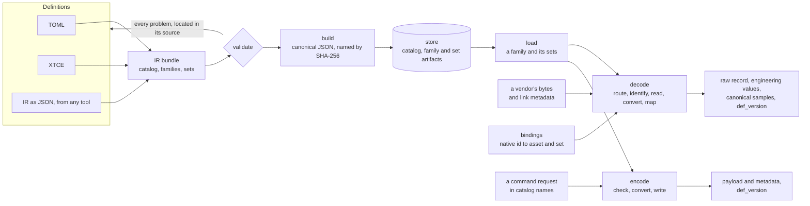
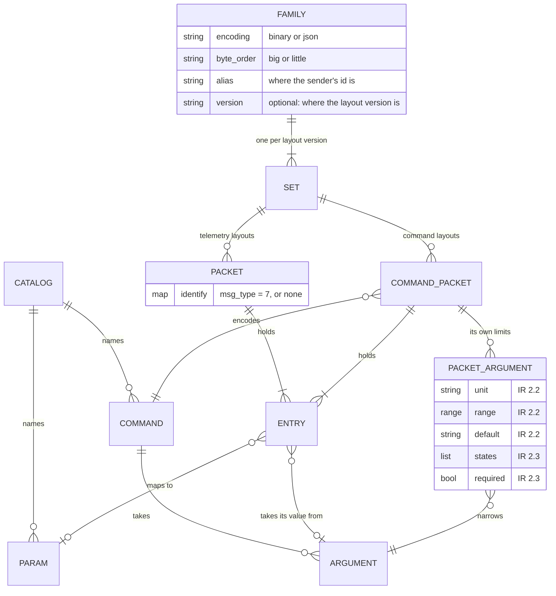
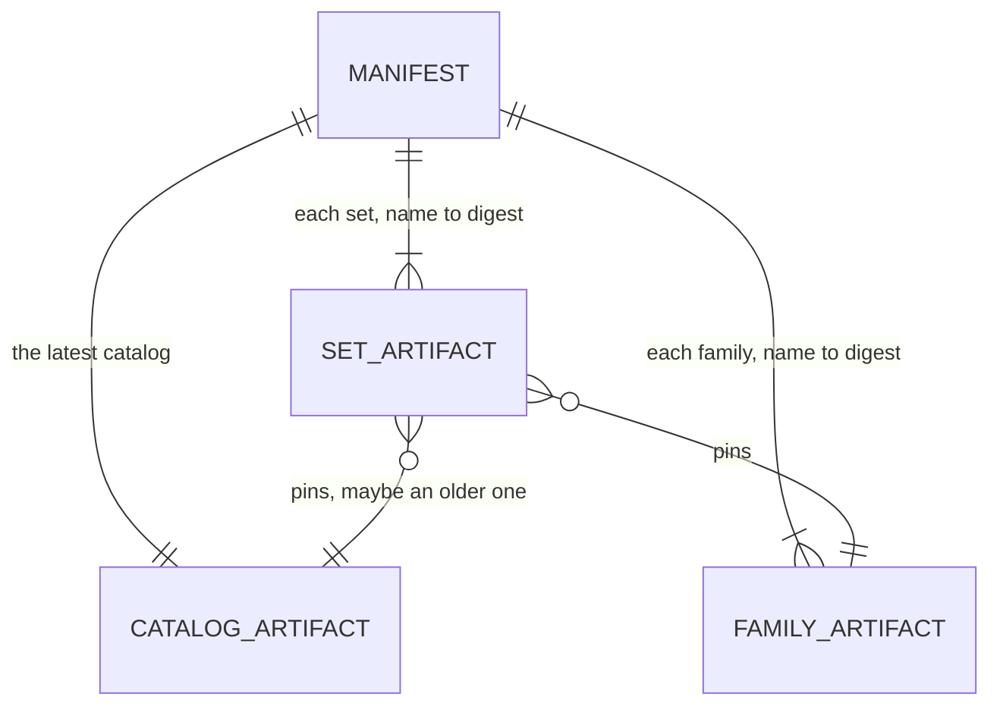

# MDL: the Morpheus Definition Language

MDL describes what the bytes from a heterogeneous fleet mean, and turns
them into one canonical model. Definitions say where each value sits in
each vendor's messages, how to convert it, and which canonical name it
maps to; MDL validates them against your catalog, builds them into
content-addressed artifacts, and decodes telemetry and encodes commands
with them.

- **Any source.** Write definitions in TOML, import a vendor's XTCE (MDL
  reads OMG XTCE 1.0 to 1.3 space system definitions, 1.0 to 1.2 checked
  against Yamcs's reading of them), or emit the IR as JSON from any tool,
  in any language. Bundles from several frontends merge into one, with a curated
  catalog taking precedence.
- **Canonical by design.** Every mapped value is checked against the
  catalog for type, unit and frame, so four vendors' bus voltages all
  arrive as `eps.bus_voltage` in volts, and one `eps.set_mode` command
  reaches every spacecraft that can switch modes.
- **Protocol-free.** Envelopes (CCSDS headers, MAVLink framing) belong to
  the link. MDL describes payloads: binary at any bit offset in either byte
  order, or JSON.
- **Identities you can keep.** Each artifact is named by the SHA-256 of
  its canonical JSON. A set's digest is the `def_version` stamped on what
  it decodes, and rebuilding after a compatible change keeps it.
- **Every problem at once.** Validation reports every error, with its file,
  line and column wherever it has one, in TOML and XTCE alike.

> Status: 0.1, the first release ([changelog](CHANGELOG.md)). What a
> release reads and writes (the IR, artifact stores, the runtime API's
> results) changes only as [compatibility](spec/compatibility.md) allows;
> the Rust API and morphc's command line may change in any 0.x release.

## How it works



Definitions come from any frontend as one IR, are checked once, and are
built into artifacts. Ground software loads the artifacts and decodes and
encodes with them at runtime, so when a definition changes, no code is
generated, and nothing that consumes the data is rebuilt.

## Definitions and the canonical catalog

MDL does two jobs, and keeps them apart.

**Definitions describe a vendor's bytes:** where each value sits in each
message, how to convert it from raw counts, and how to tell one packet
from another. Each family's definitions are its own; one vendor's
housekeeping packet says nothing about another's.

**The catalog is the one vocabulary every source maps into.** It names
each value once, with its type, unit, frame and limits: `eps.bus_voltage`
is an f64 in volts, whichever vendor's packet it came from. A definition
maps fields to catalog names, and validation checks that they agree in
type and unit (and, for vectors, frame). Whatever reads the data
downstream (an archive, alarms, a display, a model) reads catalog names,
and never needs to know whose spacecraft sent a value.

Definitions are compiled, but not into code. `morphc build` validates
them, writes each catalog, family and set in one canonical form, and
names it by its SHA-256; the decoder and encoder interpret those
artifacts at runtime. So a new packet or a changed layout is a
definitions change, and nothing that consumes the data is rebuilt. A
set's digest is the `def_version` stamped on everything it decodes or
encodes, so every value can be traced to the definitions behind it.

A decoded message keeps each entry's raw value and the canonical samples,
and gives any field's engineering value, through its conversion, on
request.

## A worked example

[`examples/beacon`](examples/beacon) is a node that sends one 4-byte
beacon. (To run the commands below, install morphc as [Quick
start](#quick-start) says, then work from `examples/`.) Its definitions, [`beacon.toml`](examples/beacon/beacon.toml), have
the three parts every build has:

- **the catalog** names the values the rest of the system wants:
  `eps.bus_voltage`, an f64 in volts, and `eps.mode`, `SAFE` or `NOMINAL`;
- **the family** says how this kind of source talks: binary, big-endian,
  and byte 0 of every beacon is the id of the node that sent it (its
  alias);
- **the set** lays the beacon out: bytes 1 and 2 are the bus voltage in
  counts of 10 mV, byte 3 the mode, each mapped to its catalog name.

[`bindings.toml`](examples/beacon/bindings.toml) says node 7 is the asset
`NODE-7`. Building checks the definitions and writes them as artifacts;
the set's digest is its `def_version`:

```console
$ morphc build beacon/beacon.toml --out store
catalog        38fca423ec69a622d0e974d77f9c3d5248f4e6d6c04baaa1785a2fa130841ffa  (written)
family beacon  498f5a56972108969202903e36ef0cc98c82b0fab5e31c1634776403a8af491f  (written)
set beacon_v1  6ac262f19dba7ca92aed618221d5e88a8d0796e9e5b26ce7415bb4f8e3cc6a66  (written)
ok: 2 params, 0 commands, 1 family, 1 set (MDL IR 2.0); 3 new artifacts written to store
```

A beacon from node 7 is `07 0B 19 01`: node 7, then 0x0B19, 2,841 counts,
then mode 1. Decoded with `--raw`, to show each layer:

```console
$ morphc decode store --family beacon --hex 070b1901 --bindings beacon/bindings.toml --time 2026-06-01T12:00:00Z --raw
set beacon_v1  packet BEACON  asset NODE-7 (native id 7)
  def_version 6ac262f19dba7ca92aed618221d5e88a8d0796e9e5b26ce7415bb4f8e3cc6a66
  ground time 2026-06-01T12:00:00Z
  param            value    unit  from
  eps.bus_voltage  28.41    V     bus
  eps.mode         NOMINAL        mode
  entries
  entry  raw   engineering
  bus    2841  28410.0
  mode   1     NOMINAL
```

Each value comes in three layers: the raw value the bits hold (2,841), the
engineering value through the field's conversion (28,410, in the field's
unit, mV), and the canonical sample, under the catalog's name and in its
unit (28.41 V). The mode's raw 1 is the state `NOMINAL`. With
`--format json`, which programs read, the decoded message is:

```json
{
  "family": "beacon",
  "native_id": 7,
  "asset": "NODE-7",
  "stand_in": false,
  "set": "beacon_v1",
  "def_version": "6ac262f19dba7ca92aed618221d5e88a8d0796e9e5b26ce7415bb4f8e3cc6a66",
  "packet": "BEACON",
  "event_time": { "kind": "ground", "time": "2026-06-01T12:00:00Z" },
  "samples": [
    { "param": "eps.bus_voltage", "value": 28.41, "unit": "V", "path": "bus",
      "index": null, "time_offset_ns": null, "quality": "good" },
    { "param": "eps.mode", "value": "NOMINAL", "unit": null, "path": "mode",
      "index": null, "time_offset_ns": null, "quality": "good" }
  ],
  "record": { "bus": 2841, "mode": 1 },
  "engineering": [
    { "path": "bus", "value": 28410.0, "quality": "good" },
    { "path": "mode", "value": "NOMINAL", "quality": "good" }
  ]
}
```

`samples` are what the rest of the system stores and plots; `record` and
`engineering` are what the vendor's bytes said, for when a value needs
explaining. A sample's `quality` says whether to trust it: `good`, or why
not (`invalid` for a value that means "no reading", `unknown_state`,
`out_of_calibration`, `out_of_range`, `non_finite`). Only a `good` sample's
value is in the param's unit; one that isn't carries the raw value, so
check the quality before storing or plotting it. The event time is the
ground time here, since the beacon carries no clock. Change the
definitions and rebuild, and what's decoded says the new `def_version`.

## Quick start

Each [release](https://github.com/zthacker/mdl/releases) has morphc built
for Linux on x86_64 and aarch64 (statically linked, for any distribution)
and macOS on Apple silicon:

```sh
v=0.2.0 target=aarch64-apple-darwin  # or x86_64-unknown-linux-musl, aarch64-unknown-linux-musl
url=https://github.com/zthacker/mdl/releases/download/v$v/morphc-$v-$target.tar.gz
curl -fL -O "$url" -O "$url.sha256"
shasum -a 256 -c "morphc-$v-$target.tar.gz.sha256"   # or sha256sum -c
tar -xzf "morphc-$v-$target.tar.gz"
"morphc-$v-$target/morphc" --version                  # put it on your PATH
```

The checksum, published beside the archive, catches a damaged download.
That the archive is the one this repository's release workflow built is
what its build provenance attestation shows, which the GitHub CLI checks:

```sh
gh attestation verify "morphc-$v-$target.tar.gz" --repo zthacker/mdl \
  --signer-workflow zthacker/mdl/.github/workflows/release.yml
```

morphc isn't notarized, so if macOS refuses to run one downloaded with a
browser, `xattr -d com.apple.quarantine morphc`, once you've checked it,
lets it run.

Or build it with Rust 1.88 or later, from the release's lockfile (the
crates aren't on crates.io yet): `cargo install --locked --git
https://github.com/zthacker/mdl --tag v0.2.0 morpheus-morphc`, or `cargo
install --locked --path crates/morphc` in a clone.

Then, in a clone of this repository:

```sh
cd examples

morphc build toml/mission xtce/demosat.xml --out store    # definitions to artifacts
morphc build -c fleet/morphc.toml --out store              # or a build file listing them
morphc inspect param eps.bus_voltage store                 # who sends it, and how
morphc encode store --set demosat --command eps.set_mode --arg mode=SAFE

# A drone's capture; one message comes from a system no binding names,
# so it's reported and the exit code is 1.
morphc decode store --family drone --records fleet/drone.jsonl --bindings fleet/bindings.toml
```

[`examples/README.md`](examples/README.md) walks through these and more,
with their output; [`crates/morphc`](crates/morphc/README.md) is morphc's
reference. `just check` runs fmt, clippy and every test; it needs Rust 1.88
or later and [`just`](https://github.com/casey/just).

## Concepts

How definitions fit together: one catalog per build; each family has a set
for each layout version; a set's packets and command packets hold entries,
and each entry maps to a catalog param or takes a command argument's value.



What definitions say:

| Term | Meaning |
| --- | --- |
| Catalog | The canonical params and commands every source maps to: names, types, units, states, frames, limits. Names are a schema: deprecated, never removed. |
| Family | One kind of source on one link: its encoding (binary or JSON), byte order, where each message says which asset sent it (its alias) and, optionally, which set it uses (its version). |
| Set | One layout version of a family: its packets, struct types and command packets, and how each entry maps to the catalog. |
| Packet | One kind of message in a set: its entries, and its identify keys, the values that tell it from the set's other packets (`msg_type = 7`). A key reads a field of the payload, a JSON Pointer, or metadata the link delivers, whichever the vendor's messages use; a packet with none is its set's catch-all. MDL assumes no framing. |
| Entry | One thing a packet holds: a field (one value, at a bit offset or a JSON Pointer), an array, a struct, padding or a checksum. A field can have a conversion, a unit and the catalog param it maps to. |
| Command packet | How a set encodes a catalog command: the fields its arguments are written to, and its constants. It may narrow an argument's range and default for its own asset, accept only some of an enum's states, or require an argument the catalog defaults, so one vendor's limits hold under a fleet's catalog. |
| Alias, native id | Where a message says which asset sent it (bits, link metadata, a JSON Pointer, or one fixed value), and the id read there. |
| Metadata | Values the link delivers with a message (`apid`, `sysid`), which a family declares; an alias, a version or an identify key can read them, and a command packet's metadata goes out with its payload for the link to frame. |

What building makes:

| Term | Meaning |
| --- | --- |
| Bundle | A catalog with families and sets: what frontends produce and validation checks. |
| Artifact | A catalog, family or set written as canonical JSON, named by its digest ([spec](spec/canonical-json.md)). |
| Store | A directory of artifacts and a manifest naming the latest build ([spec](spec/store.md)). |
| `def_version` | A set artifact's digest, stamped on everything it decodes or encodes. |

The bundle exists only in the compiler, for one build. A store keeps every
artifact any build wrote; its manifest names the latest build, and each set
pins the family and catalog it was built against, so a `def_version` on
stored telemetry always resolves. A service opens the store and holds the
loaded build in memory, validated by its own release's rules.



What comes out of decoding:

| Term | Meaning |
| --- | --- |
| Bindings, asset | Which asset each native id is over time, and, unless the family's version picks it, which set decodes it ([spec](spec/bindings.md)). |
| Record | Each present entry's raw value (padding has none, and an absent conditional entry isn't there), as the bits or the JSON hold it. |
| Engineering value | A field's raw value through its conversion, in the field's unit. |
| Sample | A canonical value: the catalog param, its value in the param's unit (the raw value when its quality isn't `good`), and its quality. |

## MDL and protobuf

Protobuf is for bytes you design: you write a `.proto`, and protobuf
decides how a message is written. MDL is for bytes someone else already
designed, such as a vendor's bit-packed telemetry, which you can describe
but not change.

| | Protobuf | MDL |
| --- | --- | --- |
| Who decides the bytes | protobuf's own wire format | the vendor; MDL describes them |
| Where a value sits | a tagged field | any bit offset and size, either byte order, or a JSON Pointer |
| Calibration and units | none | polynomials, tables, splines, states; UCUM units |
| Which message this is | the receiver knows, or an `Any` or a `oneof` says | identified by header values or link metadata |
| Meaning across sources | shared only by importing the same types | one catalog every source maps into, however each lays its values out |
| How it runs | usually code generated per message type | artifacts interpreted at runtime, no code generated |
| Provenance | none | `def_version` on every decoded or encoded value |

The two work together: MDL turns a fleet's bytes into canonical samples,
and protobuf is a good way to carry those samples between services. As an
analogy, definitions are to MDL what `.proto` files are to protobuf, and
the IR is its `FileDescriptorSet`; but where protobuf usually generates
code, MDL always reads artifacts at runtime.

## The library

morphc is a thin layer over the `mdl` crate, which any ground software can
use directly: read definitions, validate and build them, then decode with
the artifacts as a consumer loads them. The packages are named
`morpheus-mdl`, `morpheus-mdl-toml`, `morpheus-mdl-xtce` and
`morpheus-morphc`, since `mdl` and `morphc` are taken on crates.io; code
imports them as `mdl`, `mdl_toml` and `mdl_xtce`, and the binary is
`morphc`.

```rust
use mdl::artifact::{self, Written};
use mdl::bindings::Bindings;
use mdl::decode::SampleValue;
use mdl::message::{Message, Payload};
use mdl::read::read_artifact;
use mdl::route::FamilySets;
use mdl::source::Sources;
use mdl::validate::validate;

// A beacon: a node id, then the bus voltage in millivolts.
let definitions = r#"
mdl_version = "2.0"

[catalog.params."eps.bus_voltage"]
type = "f64"
unit = "V"

[[families]]
name       = "beacon"
encoding   = "binary"
byte_order = "big"
alias      = { kind = "bits", offset_bits = 0, size_bits = 8 }

[[sets]]
name   = "beacon_v1"
family = "beacon"

[[sets.packets]]
name = "BEACON"

[[sets.packets.entries]]
kind        = "field"
name        = "bus_mv"
type        = "uint"
offset_bits = 8
size_bits   = 16
unit        = "mV"
canonical   = "eps.bus_voltage"
"#;
let mut sources = Sources::new();
sources.add("beacon.toml", definitions);
let parsed = mdl_toml::read(sources.iter()).expect("the definitions read");
let validated = validate(parsed.bundle).expect("the definitions are valid");
let artifacts = artifact::build(&validated).expect("they build");

// A consumer reads the artifacts back (from a store, say) and decodes.
let load = |written: &Written| read_artifact(written.canonical.as_bytes()).expect("it reads");
let beacons = FamilySets::new(
    &load(&artifacts.families["beacon"]),
    &[load(&artifacts.sets["beacon_v1"])],
    &[load(&artifacts.catalog)],
)
.expect("the family assembles");
let bindings = Bindings::from_toml(
    r#"
mdl_version = "2.0"

[[binding]]
family         = "beacon"
native_id      = 7
asset          = "NODE-7"
set            = "beacon_v1"
effective_from = "2026-01-01T00:00:00Z"
"#,
)
.expect("the bindings read");

let received = "2026-06-01T12:00:00Z".parse().expect("an instant");
let message = Message::new(Payload::Binary(&[0x07, 0x6E, 0xFA]), received);
let decoded = beacons.decode(&message, &bindings).expect("it decodes");
assert_eq!(decoded.route.binding.asset, "NODE-7");
assert_eq!(decoded.samples[0].param, "eps.bus_voltage");
assert_eq!(decoded.samples[0].value, SampleValue::F64(28.41));
```

Encoding is the same shape: `FamilySets::encode` with a `CommandRequest`.
This example runs as a test of the TOML crate.

## Other languages

Every binding calls the runtime through one API
([spec/api.md](spec/api.md)), so a language decodes and encodes exactly as
`morphc` and the library do. [`bindings/elixir`](bindings/elixir/README.md)
is the Elixir binding: open a store, decode, encode, describe and look up
bindings from Elixir, with results as Elixir values. It's on Hex as
[`mdl`](https://hex.pm/packages/mdl), and downloads its native library
precompiled by the release for Linux on x86_64 and aarch64, and macOS,
so installing it needs no Rust.

## Contributing

`just check` runs what CI runs: formatting, clippy, every test (including
the walkthrough and the README's example), the docs, and the release
scripts' tests and check. `just props` runs
the property tests at 10,000 cases each, as CI does on pushes to main.

`just fuzz <target> [seconds]` fuzzes one target of `fuzz/` (it needs
nightly Rust and `cargo install cargo-fuzz`); CI runs each for 60 seconds
on pushes to main, and the two that generate definitions with the testkit,
`layouts` and `shapes`, for 300. What each target checks is in
`crates/mdl-fuzz`, so
`just check` replays every committed input on stable: the hand-picked
seeds in `fuzz/seeds/<target>`, the corpus grown from them in
`fuzz/corpus/<target>`, and each crash found, kept in
`fuzz/regressions/<target>` once fixed. What fuzzing finds lands in
`fuzz/grown/<target>`, untracked; `just fuzz-cmin <target>` adds to the
corpus what of it adds coverage beyond the seeds and the corpus, up to
4 KB each, and removes nothing, so history grows only by new coverage.
`just fuzz-reset <target>` minimizes a corpus again from its seeds, now
and then. `layouts` and `shapes` keep seeds only: their corpus would
record the generators' branches, and a crash they find is kept as a unit
test. After `Cargo.lock` changes, `just fuzz-lock` gives the harness the
same versions.

`just elixir` runs the Elixir binding's checks: its tests, which check its
results against morphc's, its formatting and warnings, and its native
library's clippy. It needs Elixir 1.18 or later; CI runs it on the oldest
and newest Elixir the binding supports. After `Cargo.lock` changes,
`just elixir-lock` gives the binding's native library the same versions.

`just corpus <dir>` tries the XTCE importer on real documents. Each `.xml`
file under `<dir>` that holds a SpaceSystem is imported, alone and, if
alone it has references it can't resolve, with the rest of its directory;
what imports is validated and built, and each packet decoded from payloads
made for it, all under the fuzz targets' checks. The report,
`target/xtce-corpus.md`, says what each import gave and what was refused
and why; the run fails only for a bug in MDL. No corpus is committed or
run in CI. Public XTCE to try:
[Yamcs](https://github.com/yamcs/yamcs) (its `examples` and the test
resources of `yamcs-core` and `yamcs-xtce`) and
[space_packet_parser](https://github.com/medley56/space_packet_parser)
(`tests/test_data`).

[RELEASING.md](RELEASING.md) is how a release is made, and
[CHANGELOG.md](CHANGELOG.md) what each one changed.

Issues and pull requests are welcome at <https://github.com/zthacker/mdl>.

## Layout

| Path | What |
| --- | --- |
| `crates/mdl` | the library: the IR, reading and validating it, artifacts, decoding, encoding, routing, bindings, layouts |
| `crates/mdl-toml` | the TOML frontend: definitions written as the IR spelled in TOML |
| `crates/mdl-xtce` | the XTCE importer: OMG XTCE space system definitions as bundles |
| `crates/morphc` | the command line: build, inspect, decode, encode |
| `crates/mdl-testkit` | IR generators, the list of IR features, and oracles that work out from the spec what telemetry decodes to, what commands encode to, and the error a damaged message or a refused request gives, for the property tests and the generated conformance cases (never published) |
| `crates/mdl-fuzz` | what each fuzz target checks, a test that replays every committed fuzz input, and the XTCE corpus runner (never published) |
| `fuzz` | the cargo-fuzz harness, its seeds, corpus and dictionaries, and the crashes kept as regressions |
| `bindings/elixir` | the Elixir binding: the runtime API as a Mix library over a Rustler NIF (its own Cargo workspace), tested against morphc and the conformance cases |
| `conformance` | language-neutral cases every implementation runs: canonical JSON's vectors, and decoding and encoding cases, worked out from the spec by hand or generated by the testkit's oracle ([spec](spec/conformance.md)) |
| `examples` | the worked example's beacon, a fleet in TOML and XTCE, the files an operator adds, and a walkthrough |
| `scripts` | the release checks and notes, for `just` and the release workflow |
| `spec` | normative specifications: [canonical JSON and artifact identity](spec/canonical-json.md), [frontends](spec/frontends.md), [TOML](spec/toml.md), [XTCE](spec/xtce.md), [decoding](spec/decoding.md), [encoding](spec/encoding.md), [units](spec/units.md), [bindings files](spec/bindings.md), [artifact stores](spec/store.md), [build files](spec/build-files.md), [the runtime API every binding calls](spec/api.md), [versions and compatibility](spec/compatibility.md), [conformance](spec/conformance.md) |

## License

Licensed under either of

- Apache License, Version 2.0 ([LICENSE-APACHE](LICENSE-APACHE))
- MIT license ([LICENSE-MIT](LICENSE-MIT))

at your option.

Unless you explicitly state otherwise, any contribution intentionally
submitted for inclusion in this project by you, as defined in the Apache-2.0
license, shall be dual licensed as above, without any additional terms or
conditions.
